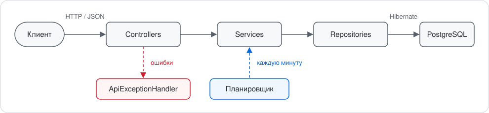

<div align="center">

# 🗓️ Room Booking

**REST-сервис бронирования переговорных комнат**

Комнаты, брони, проверка пересечений без двойного бронирования и поиск свободных окон.


</div>

---

## 📖 О проекте

Сервис помогает бронировать переговорные комнаты в офисе, коворкинге или библиотеке. Администратор заводит комнаты, сотрудники бронируют их на нужное время, а система следит, чтобы одну комнату нельзя было занять двумя бронями одновременно, даже если запросы приходят параллельно.

**Возможности**

- ✅ Управление комнатами: создание, просмотр, изменение, удаление, отключение для брони
- 🗓️ Бронирование на произвольный промежуток времени и отмена брони
- 🔒 Защита от двойного бронирования: блокировка комнаты на уровне БД
- 🕒 Свободные окна комнаты на выбранный день
- 🔎 Поиск броней по комнате, автору, статусу и периоду, с пагинацией и сортировкой
- ⏱️ Планировщик, который автоматически завершает прошедшие брони
- 🛡️ Валидация данных и единый формат ошибок RFC 9457 (`ProblemDetail`)
- 🐳 Запуск одной командой через Docker Compose

## 🧰 Технологии

| Слой | Технология |
|---|---|
| Язык | Java 21+ |
| Фреймворк | Spring Boot 3.5 (Web, Data JPA, Validation, Scheduling) |
| ORM | Hibernate / JPA, Spring Data JPA Specifications |
| База данных | PostgreSQL 17 |
| Сборка | Maven |
| Контейнеры | Docker, Docker Compose (multi-stage `Dockerfile`) |
| Вспомогательно | Lombok |

## 🏗️ Архитектура

<div align="center">
  
</div>

- **web**: контроллеры принимают запросы и проверяют данные (`@Valid`), `ApiExceptionHandler` превращает исключения в ответы.
- **service**: бизнес-правила и границы транзакций; здесь же планировщик завершения броней.
- **repository**: Spring Data JPA, запросы пересечений и блокировка комнаты.
- **dto**: объекты запросов и ответов, наружу не уходят сущности БД.
- **domain**: сущности `Room`, `Booking` и статусы.

### Модель данных

**`rooms`**

| Поле | Тип | Описание |
|---|---|---|
| `id` | bigint | Первичный ключ |
| `name` | varchar | Название, уникальное |
| `capacity` | int | Вместимость, человек |
| `location` | varchar | Расположение |
| `active` | boolean | Доступна ли для бронирования |

**`bookings`**

| Поле | Тип | Описание |
|---|---|---|
| `id` | bigint | Первичный ключ |
| `room_id` | bigint | Ссылка на комнату |
| `owner_email` | varchar | Email автора |
| `start_time`, `end_time` | timestamptz | Период брони |
| `status` | varchar | `CONFIRMED`, `CANCELLED`, `COMPLETED` |
| `version` | bigint | Версия для оптимистичной блокировки |

На `bookings` создан составной индекс по `(room_id, start_time, end_time)`, он ускоряет поиск пересечений.

### Структура проекта

```
room-booking
├── Dockerfile
├── docker-compose.yml
├── pom.xml
├── docs/architecture.svg
└── src/main
    ├── java/ru/itmo/booking
    │   ├── BookingApplication.java
    │   ├── domain/        Room, Booking, BookingStatus
    │   ├── dto/           запросы, ответы, BookingFilter, TimeSlot
    │   ├── repository/    RoomRepository, BookingRepository
    │   ├── service/       RoomService, BookingService
    │   └── web/           RoomController, BookingController, ApiExceptionHandler
    └── resources/application.yml
```

## ✅ Требования

- **Docker** с Docker Compose для запуска контейнерами
- Для запуска без Docker: **JDK 21+**, **Maven 3.9+** (или IntelliJ IDEA) и PostgreSQL 14+

## 🚀 Быстрый старт

Выбери один из вариантов.

### Вариант A. Всё в Docker

Запусти Docker Desktop, дождись полной загрузки и выполни в корне проекта:

```bash
docker compose up --build
```

Compose соберёт образ приложения, поднимет PostgreSQL и дождётся его готовности. Сервис будет доступен на **http://localhost:8080**, база на порту **5433** (чтобы не конфликтовать с локальным PostgreSQL на 5432).

Остановить: `docker compose down`. Остановить и удалить данные: `docker compose down -v`.

### Вариант B. База в Docker, приложение из IDE

```bash
docker compose up -d db
mvn spring-boot:run
```

Или запусти `BookingApplication` в IntelliJ IDEA кнопкой ▶ рядом с `main`. Настройки по умолчанию уже указывают на `localhost:5433`.

### Вариант C. Локальный PostgreSQL без Docker

```bash
psql postgres -c "CREATE ROLE booking LOGIN PASSWORD 'booking';"
psql postgres -c "CREATE DATABASE booking OWNER booking;"

SPRING_DATASOURCE_URL=jdbc:postgresql://localhost:5432/booking mvn spring-boot:run
```

### Проверка

```bash
curl http://localhost:8080/api/rooms
```

В ответ придёт пустая страница комнат.

## ⚙️ Конфигурация

Настройки лежат в `src/main/resources/application.yml`:

| Параметр | Значение по умолчанию |
|---|---|
| `spring.datasource.url` | `jdbc:postgresql://localhost:5433/booking` |
| `spring.datasource.username` | `booking` |
| `spring.datasource.password` | `booking` |
| `spring.jpa.hibernate.ddl-auto` | `update` |
| `server.port` | `8080` (по умолчанию Spring Boot) |

Любой параметр можно переопределить переменной окружения:

```bash
SPRING_DATASOURCE_PASSWORD=secret SERVER_PORT=9090 mvn spring-boot:run
```

## 📡 API

Время передаётся в формате **ISO-8601 в UTC**, например `2030-05-20T10:00:00Z`. Начало брони должно быть в будущем.

### Комнаты: `/api/rooms`

| Метод | Путь | Описание | Ответ |
|---|---|---|---|
| `GET` | `/api/rooms?minCapacity=&page=&size=&sort=` | Список комнат | `200` |
| `GET` | `/api/rooms/{id}` | Комната по id | `200` |
| `GET` | `/api/rooms/{id}/availability?date=yyyy-MM-dd` | Свободные окна на день (по UTC) | `200` |
| `POST` | `/api/rooms` | Создать комнату | `201` |
| `PUT` | `/api/rooms/{id}` | Полностью обновить комнату | `200` |
| `DELETE` | `/api/rooms/{id}` | Удалить комнату (без броней) | `204` |

Поля комнаты:

| Поле | Обязательное | Правила |
|---|:---:|---|
| `name` | ✅ | Не пустое, уникальное |
| `capacity` | ✅ | Больше 0 |
| `location` | | Произвольная строка |
| `active` | | По умолчанию `true`; неактивную комнату забронировать нельзя |

### Брони: `/api/bookings`

| Метод | Путь | Описание | Ответ |
|---|---|---|---|
| `GET` | `/api/bookings` | Поиск броней с фильтрами | `200` |
| `GET` | `/api/bookings/{id}` | Бронь по id | `200` |
| `POST` | `/api/bookings` | Создать бронь | `201` |
| `PATCH` | `/api/bookings/{id}/cancel` | Отменить бронь | `200` |

Поля брони при создании:

| Поле | Обязательное | Правила |
|---|:---:|---|
| `roomId` | ✅ | Существующая комната |
| `ownerEmail` | ✅ | Корректный email |
| `startTime` | ✅ | Строго в будущем |
| `endTime` | ✅ | Позже `startTime` |

Параметры поиска `GET /api/bookings`, все необязательные:

| Параметр | Поведение | Пример |
|---|---|---|
| `roomId` | Брони конкретной комнаты | `roomId=1` |
| `ownerEmail` | Точный email, без учёта регистра | `ownerEmail=anna@mail.ru` |
| `status` | `CONFIRMED`, `CANCELLED` или `COMPLETED` | `status=CONFIRMED` |
| `from` | Брони, начинающиеся не раньше момента | `from=2030-05-20T00:00:00Z` |
| `to` | Брони, начинающиеся не позже момента | `to=2030-05-21T00:00:00Z` |
| `page`, `size` | Страница (с нуля) и её размер | `page=0&size=10` |
| `sort` | Поле и направление | `sort=startTime,desc` |

Для `sort` доступны поля: `id`, `ownerEmail`, `startTime`, `endTime`, `status`.

### Пример сценария

**1. Создать комнату**

```bash
curl -X POST http://localhost:8080/api/rooms \
  -H "Content-Type: application/json" \
  -d '{"name": "Альфа", "capacity": 8, "location": "2 этаж"}'
```

```json
{ "id": 1, "name": "Альфа", "capacity": 8, "location": "2 этаж", "active": true }
```

**2. Забронировать**

```bash
curl -X POST http://localhost:8080/api/bookings \
  -H "Content-Type: application/json" \
  -d '{
    "roomId": 1,
    "ownerEmail": "anna@mail.ru",
    "startTime": "2030-05-20T10:00:00Z",
    "endTime": "2030-05-20T11:00:00Z"
  }'
```

```json
{
  "id": 1,
  "roomId": 1,
  "roomName": "Альфа",
  "ownerEmail": "anna@mail.ru",
  "startTime": "2030-05-20T10:00:00Z",
  "endTime": "2030-05-20T11:00:00Z",
  "status": "CONFIRMED"
}
```

**3. Посмотреть свободные окна**

```bash
curl "http://localhost:8080/api/rooms/1/availability?date=2030-05-20"
```

```json
[
  { "from": "2030-05-20T00:00:00Z", "to": "2030-05-20T10:00:00Z" },
  { "from": "2030-05-20T11:00:00Z", "to": "2030-05-21T00:00:00Z" }
]
```

**4. Найти брони и отменить**

```bash
curl "http://localhost:8080/api/bookings?roomId=1&status=CONFIRMED&sort=startTime,desc"
curl -X PATCH http://localhost:8080/api/bookings/1/cancel
```

## 📏 Бизнес-правила

| Правило | Результат при нарушении |
|---|---|
| Начало брони в будущем, конец позже начала | `400` со списком полей |
| Комната существует | `404` |
| Комната активна | `409` |
| Нет пересечения с другой подтверждённой бронью комнаты | `409` «Комната занята на выбранное время» |
| Отменить можно только `CONFIRMED` бронь, которая ещё не началась | `409` |
| Брони смежных интервалов (11:00–12:00 сразу после 10:00–11:00) допустимы | `201` |
| Удалить можно только комнату без броней | `409` |

Отменённые брони не мешают новым: комната снова считается свободной.

## 🔒 Как исключено двойное бронирование

Создание брони выполняется одной транзакцией:

1. Строка комнаты блокируется через `SELECT ... FOR UPDATE` (`@Lock(PESSIMISTIC_WRITE)`).
2. Проверяется пересечение с подтверждёнными бронями комнаты.
3. Бронь сохраняется, транзакция фиксируется и блокировка снимается.

Если два запроса одновременно бронируют одну комнату, второй дожидается первого, после чего видит его бронь и получает `409`. Брони разных комнат друг друга не блокируют. Параллельные изменения одной брони, например двойная отмена, защищены оптимистичной блокировкой через поле `@Version`.

Условие пересечения периодов `[A, B)` и `[C, D)`: `C < B` и `D > A`.

## ⏱️ Планировщик

Раз в минуту `BookingService.completeFinished()` одним `UPDATE` переводит все `CONFIRMED` брони, закончившиеся в прошлом, в статус `COMPLETED`. Количество завершённых броней пишется в лог.

## ❗ Формат ошибок

Ошибки возвращаются в формате `application/problem+json`.

**`409`: комната занята**
```json
{
  "type": "about:blank",
  "title": "Conflict",
  "status": 409,
  "detail": "Комната занята на выбранное время",
  "instance": "/api/bookings"
}
```

**`400`: ошибка валидации** (в `errors` перечислены невалидные поля)
```json
{
  "type": "about:blank",
  "title": "Bad Request",
  "status": 400,
  "detail": "Invalid request content.",
  "instance": "/api/bookings",
  "errors": { "startTime": "должно содержать будущую дату", "periodValid": "Время окончания должно быть позже начала" }
}
```

**`404`: не найдено**
```json
{
  "type": "about:blank",
  "title": "Not Found",
  "status": 404,
  "detail": "Комната с id=99 не найдена",
  "instance": "/api/rooms/99"
}
```

## 🗄️ Работа с базой данных

Подключиться к базе в контейнере:

```bash
docker compose exec db psql -U booking -d booking
```

Полезные запросы:

```sql
\d bookings
SELECT id, room_id, start_time, end_time, status FROM bookings ORDER BY start_time;
```

## 🛠️ Решение проблем

| Симптом | Причина и решение |
|---|---|
| `failed to connect to the docker API` | Docker не запущен. Запусти Docker Desktop и повтори команду |
| `Connection refused` на порту 5433 | База не поднята. Выполни `docker compose up -d db` |
| `FATAL: role "booking" does not exist` | Приложение подключилось к другому PostgreSQL. Проверь порт в URL: `lsof -i :5433`, либо создай роль и базу (вариант C) |
| `port is already allocated` | Порт 5433 или 8080 занят. Измени проброс в `docker-compose.yml` или останови другой процесс |
| `400` и `JSON parse error` | Неверный формат времени. Используй ISO-8601 с `Z`: `2030-05-20T10:00:00Z` |
| `400` с `startTime` в `errors` | Начало брони в прошлом. Укажи будущее время |
| `Port 8080 was already in use` | Запусти с `SERVER_PORT=9090` или останови другой процесс |
| `release version 5 not supported` в IntelliJ | Проект ещё не импортирован. Дождись индексации и нажми *Reload All Maven Projects* |
| Красный код в IDE, а приложение работает | Включи обработку аннотаций Lombok: *Settings → Compiler → Annotation Processors → Enable annotation processing* и проверь плагин Lombok |
| Ошибка Lombok на новой JDK (`TypeTag :: UNKNOWN`) | Добавь в `pom.xml` в `<properties>` строку `<lombok.version>1.18.42</lombok.version>` |

## 🧭 Планы развития

- [ ] Тест на конкурентность: 10 потоков бронируют одно время, проходит ровно одна бронь (Testcontainers)
- [ ] Миграции схемы через Flyway вместо `ddl-auto: update`
- [ ] Ограничение `EXCLUDE USING gist` в PostgreSQL как вторая линия защиты от пересечений
- [ ] Часовые пояса и рабочие часы комнат
- [ ] Авторизация и роли: администратор и сотрудник
- [ ] Документация API через Swagger / OpenAPI

> ℹ️ В текущей версии схема создаётся автоматически (`ddl-auto: update`). Это удобно для разработки, но для рабочей среды её нужно заменить на управляемые миграции, а пароли вынести в переменные окружения.
<div align="center">

# 🗓️ Room Booking

**REST-сервис бронирования переговорных комнат**

Комнаты, брони, проверка пересечений без двойного бронирования и поиск свободных окон.


</div>

---

## 📖 О проекте

Сервис помогает бронировать переговорные комнаты в офисе, коворкинге или библиотеке. Администратор заводит комнаты, сотрудники бронируют их на нужное время, а система следит, чтобы одну комнату нельзя было занять двумя бронями одновременно, даже если запросы приходят параллельно.

**Возможности**

- ✅ Управление комнатами: создание, просмотр, изменение, удаление, отключение для брони
- 🗓️ Бронирование на произвольный промежуток времени и отмена брони
- 🔒 Защита от двойного бронирования: блокировка комнаты на уровне БД
- 🕒 Свободные окна комнаты на выбранный день
- 🔎 Поиск броней по комнате, автору, статусу и периоду, с пагинацией и сортировкой
- ⏱️ Планировщик, который автоматически завершает прошедшие брони
- 🛡️ Валидация данных и единый формат ошибок RFC 9457 (`ProblemDetail`)
- 🐳 Запуск одной командой через Docker Compose

## 🧰 Технологии

| Слой | Технология |
|---|---|
| Язык | Java 21+ |
| Фреймворк | Spring Boot 3.5 (Web, Data JPA, Validation, Scheduling) |
| ORM | Hibernate / JPA, Spring Data JPA Specifications |
| База данных | PostgreSQL 17 |
| Сборка | Maven |
| Контейнеры | Docker, Docker Compose (multi-stage `Dockerfile`) |
| Вспомогательно | Lombok |

## 🏗️ Архитектура

<div align="center">
  
</div>

- **web**: контроллеры принимают запросы и проверяют данные (`@Valid`), `ApiExceptionHandler` превращает исключения в ответы.
- **service**: бизнес-правила и границы транзакций; здесь же планировщик завершения броней.
- **repository**: Spring Data JPA, запросы пересечений и блокировка комнаты.
- **dto**: объекты запросов и ответов, наружу не уходят сущности БД.
- **domain**: сущности `Room`, `Booking` и статусы.

### Модель данных

**`rooms`**

| Поле | Тип | Описание |
|---|---|---|
| `id` | bigint | Первичный ключ |
| `name` | varchar | Название, уникальное |
| `capacity` | int | Вместимость, человек |
| `location` | varchar | Расположение |
| `active` | boolean | Доступна ли для бронирования |

**`bookings`**

| Поле | Тип | Описание |
|---|---|---|
| `id` | bigint | Первичный ключ |
| `room_id` | bigint | Ссылка на комнату |
| `owner_email` | varchar | Email автора |
| `start_time`, `end_time` | timestamptz | Период брони |
| `status` | varchar | `CONFIRMED`, `CANCELLED`, `COMPLETED` |
| `version` | bigint | Версия для оптимистичной блокировки |

На `bookings` создан составной индекс по `(room_id, start_time, end_time)`, он ускоряет поиск пересечений.

### Структура проекта

```
room-booking
├── Dockerfile
├── docker-compose.yml
├── pom.xml
├── docs/architecture.svg
└── src/main
    ├── java/ru/itmo/booking
    │   ├── BookingApplication.java
    │   ├── domain/        Room, Booking, BookingStatus
    │   ├── dto/           запросы, ответы, BookingFilter, TimeSlot
    │   ├── repository/    RoomRepository, BookingRepository
    │   ├── service/       RoomService, BookingService
    │   └── web/           RoomController, BookingController, ApiExceptionHandler
    └── resources/application.yml
```

## ✅ Требования

- **Docker** с Docker Compose для запуска контейнерами
- Для запуска без Docker: **JDK 21+**, **Maven 3.9+** (или IntelliJ IDEA) и PostgreSQL 14+

## 🚀 Быстрый старт

Выбери один из вариантов.

### Вариант A. Всё в Docker

Запусти Docker Desktop, дождись полной загрузки и выполни в корне проекта:

```bash
docker compose up --build
```

Compose соберёт образ приложения, поднимет PostgreSQL и дождётся его готовности. Сервис будет доступен на **http://localhost:8080**, база на порту **5433** (чтобы не конфликтовать с локальным PostgreSQL на 5432).

Остановить: `docker compose down`. Остановить и удалить данные: `docker compose down -v`.

### Вариант B. База в Docker, приложение из IDE

```bash
docker compose up -d db
mvn spring-boot:run
```

Или запусти `BookingApplication` в IntelliJ IDEA кнопкой ▶ рядом с `main`. Настройки по умолчанию уже указывают на `localhost:5433`.

### Вариант C. Локальный PostgreSQL без Docker

```bash
psql postgres -c "CREATE ROLE booking LOGIN PASSWORD 'booking';"
psql postgres -c "CREATE DATABASE booking OWNER booking;"

SPRING_DATASOURCE_URL=jdbc:postgresql://localhost:5432/booking mvn spring-boot:run
```

### Проверка

```bash
curl http://localhost:8080/api/rooms
```

В ответ придёт пустая страница комнат.

## ⚙️ Конфигурация

Настройки лежат в `src/main/resources/application.yml`:

| Параметр | Значение по умолчанию |
|---|---|
| `spring.datasource.url` | `jdbc:postgresql://localhost:5433/booking` |
| `spring.datasource.username` | `booking` |
| `spring.datasource.password` | `booking` |
| `spring.jpa.hibernate.ddl-auto` | `update` |
| `server.port` | `8080` (по умолчанию Spring Boot) |

Любой параметр можно переопределить переменной окружения:

```bash
SPRING_DATASOURCE_PASSWORD=secret SERVER_PORT=9090 mvn spring-boot:run
```

## 📡 API

Время передаётся в формате **ISO-8601 в UTC**, например `2030-05-20T10:00:00Z`. Начало брони должно быть в будущем.

### Комнаты: `/api/rooms`

| Метод | Путь | Описание | Ответ |
|---|---|---|---|
| `GET` | `/api/rooms?minCapacity=&page=&size=&sort=` | Список комнат | `200` |
| `GET` | `/api/rooms/{id}` | Комната по id | `200` |
| `GET` | `/api/rooms/{id}/availability?date=yyyy-MM-dd` | Свободные окна на день (по UTC) | `200` |
| `POST` | `/api/rooms` | Создать комнату | `201` |
| `PUT` | `/api/rooms/{id}` | Полностью обновить комнату | `200` |
| `DELETE` | `/api/rooms/{id}` | Удалить комнату (без броней) | `204` |

Поля комнаты:

| Поле | Обязательное | Правила |
|---|:---:|---|
| `name` | ✅ | Не пустое, уникальное |
| `capacity` | ✅ | Больше 0 |
| `location` | | Произвольная строка |
| `active` | | По умолчанию `true`; неактивную комнату забронировать нельзя |

### Брони: `/api/bookings`

| Метод | Путь | Описание | Ответ |
|---|---|---|---|
| `GET` | `/api/bookings` | Поиск броней с фильтрами | `200` |
| `GET` | `/api/bookings/{id}` | Бронь по id | `200` |
| `POST` | `/api/bookings` | Создать бронь | `201` |
| `PATCH` | `/api/bookings/{id}/cancel` | Отменить бронь | `200` |

Поля брони при создании:

| Поле | Обязательное | Правила |
|---|:---:|---|
| `roomId` | ✅ | Существующая комната |
| `ownerEmail` | ✅ | Корректный email |
| `startTime` | ✅ | Строго в будущем |
| `endTime` | ✅ | Позже `startTime` |

Параметры поиска `GET /api/bookings`, все необязательные:

| Параметр | Поведение | Пример |
|---|---|---|
| `roomId` | Брони конкретной комнаты | `roomId=1` |
| `ownerEmail` | Точный email, без учёта регистра | `ownerEmail=anna@mail.ru` |
| `status` | `CONFIRMED`, `CANCELLED` или `COMPLETED` | `status=CONFIRMED` |
| `from` | Брони, начинающиеся не раньше момента | `from=2030-05-20T00:00:00Z` |
| `to` | Брони, начинающиеся не позже момента | `to=2030-05-21T00:00:00Z` |
| `page`, `size` | Страница (с нуля) и её размер | `page=0&size=10` |
| `sort` | Поле и направление | `sort=startTime,desc` |

Для `sort` доступны поля: `id`, `ownerEmail`, `startTime`, `endTime`, `status`.

### Пример сценария

**1. Создать комнату**

```bash
curl -X POST http://localhost:8080/api/rooms \
  -H "Content-Type: application/json" \
  -d '{"name": "Альфа", "capacity": 8, "location": "2 этаж"}'
```

```json
{ "id": 1, "name": "Альфа", "capacity": 8, "location": "2 этаж", "active": true }
```

**2. Забронировать**

```bash
curl -X POST http://localhost:8080/api/bookings \
  -H "Content-Type: application/json" \
  -d '{
    "roomId": 1,
    "ownerEmail": "anna@mail.ru",
    "startTime": "2030-05-20T10:00:00Z",
    "endTime": "2030-05-20T11:00:00Z"
  }'
```

```json
{
  "id": 1,
  "roomId": 1,
  "roomName": "Альфа",
  "ownerEmail": "anna@mail.ru",
  "startTime": "2030-05-20T10:00:00Z",
  "endTime": "2030-05-20T11:00:00Z",
  "status": "CONFIRMED"
}
```

**3. Посмотреть свободные окна**

```bash
curl "http://localhost:8080/api/rooms/1/availability?date=2030-05-20"
```

```json
[
  { "from": "2030-05-20T00:00:00Z", "to": "2030-05-20T10:00:00Z" },
  { "from": "2030-05-20T11:00:00Z", "to": "2030-05-21T00:00:00Z" }
]
```

**4. Найти брони и отменить**

```bash
curl "http://localhost:8080/api/bookings?roomId=1&status=CONFIRMED&sort=startTime,desc"
curl -X PATCH http://localhost:8080/api/bookings/1/cancel
```

## 📏 Бизнес-правила

| Правило | Результат при нарушении |
|---|---|
| Начало брони в будущем, конец позже начала | `400` со списком полей |
| Комната существует | `404` |
| Комната активна | `409` |
| Нет пересечения с другой подтверждённой бронью комнаты | `409` «Комната занята на выбранное время» |
| Отменить можно только `CONFIRMED` бронь, которая ещё не началась | `409` |
| Брони смежных интервалов (11:00–12:00 сразу после 10:00–11:00) допустимы | `201` |
| Удалить можно только комнату без броней | `409` |

Отменённые брони не мешают новым: комната снова считается свободной.

## 🔒 Как исключено двойное бронирование

Создание брони выполняется одной транзакцией:

1. Строка комнаты блокируется через `SELECT ... FOR UPDATE` (`@Lock(PESSIMISTIC_WRITE)`).
2. Проверяется пересечение с подтверждёнными бронями комнаты.
3. Бронь сохраняется, транзакция фиксируется и блокировка снимается.

Если два запроса одновременно бронируют одну комнату, второй дожидается первого, после чего видит его бронь и получает `409`. Брони разных комнат друг друга не блокируют. Параллельные изменения одной брони, например двойная отмена, защищены оптимистичной блокировкой через поле `@Version`.

Условие пересечения периодов `[A, B)` и `[C, D)`: `C < B` и `D > A`.

## ⏱️ Планировщик

Раз в минуту `BookingService.completeFinished()` одним `UPDATE` переводит все `CONFIRMED` брони, закончившиеся в прошлом, в статус `COMPLETED`. Количество завершённых броней пишется в лог.

## ❗ Формат ошибок

Ошибки возвращаются в формате `application/problem+json`.

**`409`: комната занята**
```json
{
  "type": "about:blank",
  "title": "Conflict",
  "status": 409,
  "detail": "Комната занята на выбранное время",
  "instance": "/api/bookings"
}
```

**`400`: ошибка валидации** (в `errors` перечислены невалидные поля)
```json
{
  "type": "about:blank",
  "title": "Bad Request",
  "status": 400,
  "detail": "Invalid request content.",
  "instance": "/api/bookings",
  "errors": { "startTime": "должно содержать будущую дату", "periodValid": "Время окончания должно быть позже начала" }
}
```

**`404`: не найдено**
```json
{
  "type": "about:blank",
  "title": "Not Found",
  "status": 404,
  "detail": "Комната с id=99 не найдена",
  "instance": "/api/rooms/99"
}
```

## 🗄️ Работа с базой данных

Подключиться к базе в контейнере:

```bash
docker compose exec db psql -U booking -d booking
```

Полезные запросы:

```sql
\d bookings
SELECT id, room_id, start_time, end_time, status FROM bookings ORDER BY start_time;
```

## 🛠️ Решение проблем

| Симптом | Причина и решение |
|---|---|
| `failed to connect to the docker API` | Docker не запущен. Запусти Docker Desktop и повтори команду |
| `Connection refused` на порту 5433 | База не поднята. Выполни `docker compose up -d db` |
| `FATAL: role "booking" does not exist` | Приложение подключилось к другому PostgreSQL. Проверь порт в URL: `lsof -i :5433`, либо создай роль и базу (вариант C) |
| `port is already allocated` | Порт 5433 или 8080 занят. Измени проброс в `docker-compose.yml` или останови другой процесс |
| `400` и `JSON parse error` | Неверный формат времени. Используй ISO-8601 с `Z`: `2030-05-20T10:00:00Z` |
| `400` с `startTime` в `errors` | Начало брони в прошлом. Укажи будущее время |
| `Port 8080 was already in use` | Запусти с `SERVER_PORT=9090` или останови другой процесс |
| `release version 5 not supported` в IntelliJ | Проект ещё не импортирован. Дождись индексации и нажми *Reload All Maven Projects* |
| Красный код в IDE, а приложение работает | Включи обработку аннотаций Lombok: *Settings → Compiler → Annotation Processors → Enable annotation processing* и проверь плагин Lombok |
| Ошибка Lombok на новой JDK (`TypeTag :: UNKNOWN`) | Добавь в `pom.xml` в `<properties>` строку `<lombok.version>1.18.42</lombok.version>` |

## 🧭 Планы развития

- [ ] Тест на конкурентность: 10 потоков бронируют одно время, проходит ровно одна бронь (Testcontainers)
- [ ] Миграции схемы через Flyway вместо `ddl-auto: update`
- [ ] Ограничение `EXCLUDE USING gist` в PostgreSQL как вторая линия защиты от пересечений
- [ ] Часовые пояса и рабочие часы комнат
- [ ] Авторизация и роли: администратор и сотрудник
- [ ] Документация API через Swagger / OpenAPI

> ℹ️ В текущей версии схема создаётся автоматически (`ddl-auto: update`). Это удобно для разработки, но для рабочей среды её нужно заменить на управляемые миграции, а пароли вынести в переменные окружения.

